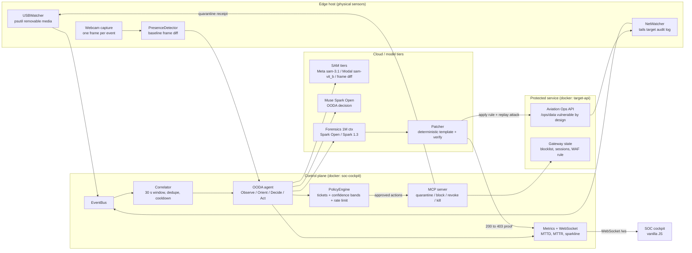

# Meta-Guardian

**Autonomous cyber-physical security, live quarantine and self-healing SOC agent.**

Built for the **Meta Global AI Developer Hackathon 2026** (Indie Track) by Mustafa Çalışkan.

## Why this exists

Airport and critical-facility operations already have cameras and already have logs, but the
two never meet. A camera sees a person at a console; the SIEM sees a privileged command from
an unknown IP; neither system can answer the question that actually matters: *was an
authorised human physically present when this action ran?* After field experience at Sabiha
Gökçen, the operational gap was concrete: physical access control and cyber telemetry are
separate budgets, separate teams and separate alerts, so the one event that matters — a
physical action correlated with a digital one — is the one nobody can prove. Stitching that
gap today means shipping 30 FPS of video to a cloud, which no operations team will do for
privacy, bandwidth and cost reasons.

## What we built

Meta-Guardian is a blue-team agent that runs on the edge host, not in a dashboard. It watches
removable media and the protected service's audit log, captures exactly **one** camera frame
per event, and asks three questions in order: did something physically happen, is the person
authorised (change ticket plus a calibrated presence check), and does the evidence justify
action. A deterministic policy gate — not the model — decides whether containment executes
automatically, waits for a human, or is suppressed. Containment is real: the payload is moved
to a read-only vault, the attacker IP is blocked at the gateway, the session is revoked. Then
the agent proves the fix instead of asserting it: it replays the same attack and requires
`HTTP 200` to become `HTTP 403`, rolling back automatically if it does not.

## What is proven, and how

Every claim below is reproducible from this repository, with the command next to it.

- **The detection loop is closed.** `python scripts/trigger_attack.py --exfil --watch --patch`
  sends a real HTTP request to the protected service. No synthetic events, no test hook. The
  audit log drives the watcher, the correlator opens the incident and containment runs.
- **Containment and self-healing are measured**, not asserted: MTTD 236–371 ms, MTTR 42–93 ms,
  patch-and-verify 115–123 ms on the Docker stack. `GET /api/metrics` recomputes them from the
  incidents on screen, so the cockpit cannot display a hard-coded number.
- **Cloud output is verified, not trusted.** All 7 archive citations in the 1M-context run were
  checked against real file lines, and `earliest_discovery` matched the archive manifest exactly
  (`docs/FULL_ARCHIVE_RUN.md`).
- **The physical claim is a real model**, not a drawn rectangle: segmentation runs through Modal
  `sam-vit_b` and the saved mask is the model's own output
  (`python scripts/test_modal_sam.py --bridge`).
- **Versus a credible legacy engine**, on the same three scenarios: 50% vs 100% recall on
  attacks and 100% vs 0% false positives on the approved-maintenance case
  (`python scripts/benchmark_baseline.py --patch`).
- **Machine-checkable**: 242 tests, and every module runs offline in `mock` mode.

## Architecture



## Repository layout

```
backend/
  main.py            FastAPI control server + WebSocket SOC stream (port 8000)
  target_service.py  Protected Aviation Ops microservice (port 8001)
  config.py          Environment-driven settings and runtime modes
  models.py          Pydantic schemas shared by every layer
  casefile.py        SOC case file export (markdown + json)
  netguard.py        Infrastructure address classification (never blockable)
  llm/               Provider abstraction: mock, replay, live, record
  vision/            Webcam capture, ROI detection, presence detector, SAM bridge
  edge/              USB/network watcher, correlator, policy engine, OODA agent, MCP server
  cloud/             Sanitizer, citation-verified forensics, hot-patcher
frontend/            Dark SOC cockpit (vanilla JS, no Streamlit, no build step)
docker-compose.yml   target-api + soc-cockpit, healthchecked
data/                Scenario frames, 30-day SIEM archive, replay fixtures
scripts/             Data generation, attack trigger, benchmarks, Modal SAM service
tests/               Pytest unit and integration tests
```

## Quickstart

```powershell
python -m venv .venv
.\.venv\Scripts\Activate.ps1
pip install -r requirements.txt
Copy-Item .env.example .env
python scripts/generate_data.py
python scripts/generate_scenario_frames.py
python scripts/smoke_test_providers.py
python -m pytest
```

The default `.env` runs in `LLM_MODE=mock`, so the whole system works with **no API keys and
no internet**.

Run the two services in separate terminals, then open the cockpit:

```powershell
python -m backend.target_service     # protected Aviation Ops API, port 8001
python -m backend.main               # control center + SOC cockpit, port 8000
# then browse http://127.0.0.1:8000
```

Or run the whole stack in containers:

```bash
docker compose up --build              # target-api :8001 + soc-cockpit :8000
```

### Runtime modes

| Mode | Behaviour |
|---|---|
| `mock` | Deterministic canned model responses. Fully offline development and UI work. |
| `replay` | Replays recorded fixtures from `data/fixtures/`. Demo recording insurance. |
| `live` | Calls Meta / Baseten / Fireworks OpenAI-compatible endpoints. |
| `record` | Calls live endpoints and stores the replies as replayable fixtures. |

### Model routing: which model, where, and why

| Layer | Provider | Model | Why this one |
|---|---|---|---|
| Edge OODA | self-hosted / Fireworks / Baseten | `muse-glimmer` | Open-weight and edge-sized: the decision must sit next to the sensor, and camera frames must not leave the host. |
| OODA reasoning (demo + bonus track) | Baseten | `meta-models/muse-spark-open-1026` | Open weights served remotely, so the open-weights claim is backed by a real pipeline call rather than a smoke test. Hackathon participant-guide id. |
| Forensics (1M context) | Meta Model API | `muse-spark-1.3` | Thirty days of SIEM history plus policy text needs the hosted 1M window; measured at 1,026,768 input tokens in one request. |
| Patch planning | Meta Model API | `muse-spark-1.3` | Only selects an allowlisted template. The model never emits executable code. |
| Physical evidence | Meta Model API, Modal, offline | `sam-3.1`, `sam-vit_b`, frame diff | Three tiers so the pixel mask is produced by a real segmenter when one is reachable, and honestly labelled when it is not. |
| Containment | none | MCP tools | Deliberate: destructive actions are deterministic code paths, not model output. |

`muse-spark-open-1m` is **not** a Model API model id; the 1M context lives on
`muse-spark-1.3`. **Muse Code is a terminal/CI coding agent, not an API model** — use
`muse-spark-1.3` to generate patch plans.

## Detection pipeline

```
event -> capture_frame() -> detect_motion() -> SAMBridge.segment()
      -> OODAAgent.observe/orient -> decide (LLM, JSON validated)
      -> PolicyEngine.evaluate (tickets + confidence + rate limit)
      -> MCPServer.call_tool (real containment) -> Incident
```

- **Watchers** (`backend/edge/usb_net_watcher.py`): `psutil` partition polling with a
  removable-only filter, and an incremental tail of the target's JSONL audit log. Events carry
  the request's own timestamp, not the moment the tailer read the line.
- **Correlator** (`backend/edge/correlator.py`): bundles individual events (USB plus network
  within 30 s, an admin command, or a delayed USB-only bundle), with dedupe and a per-signature
  cooldown so an event storm cannot spawn duplicates.
- **Presence** (`backend/vision/operator.py`): `operator_present` is computed from pixels —
  motion against a calibrated baseline. It is a motion heuristic, not face recognition; if the
  frame differs from the baseline by more than 45% it reports *presence unknown* rather than
  guessing.
- **OODA** (`backend/edge/ooda_agent.py`): validates the LLM JSON, replaces hallucinated
  IPs/sessions with evidence, executes only policy-approved actions and returns a fully
  populated `Incident` (scenarios A/B/C).
- **Policy** (`backend/edge/policy_engine.py`): change-ticket authorisation, confidence bands
  (`>= 0.85` auto, `0.50–0.85` approval, `< 0.50` monitor) and a sliding-window rate limiter.
  The LLM can propose, never self-authorise.
- **MCP** (`backend/edge/mcp_server.py`): `quarantine_usb_file`, `block_ip_on_gateway`,
  `revoke_session_token`, `kill_process` — real side effects, plus a JSON-RPC
  `tools/list` / `tools/call` surface.
- **Forensics** (`backend/cloud/forensics.py`): a sanitized bundle plus prioritized archive
  excerpts go to the 1M-context model. **Every citation is verified against the real file and
  line**; invented lines are dropped and the deterministic manifest report is used instead.
- **Patcher** (`backend/cloud/patcher.py`): the model never writes executable code. It selects
  an allowlisted template, the rule is hot-loaded, the *same* attack is replayed and must
  return 403/401. If it does not, the patch is rolled back automatically.

## Real detection loop

The cockpit also has a scenario injector, and it is labelled as such: it injects synthetic
*events* but still runs real vision, policy and containment. Real detection does not depend
on it.

```powershell
# terminal 1
python -m backend.target_service
# terminal 2 (watchers on by default)
python -m backend.main
# terminal 3: real HTTP attack against :8001, waits for the incident, patches
python scripts/trigger_attack.py --reset --exfil --watch --patch
```

`trigger_attack.py` never calls `/api/simulate`. It sends real requests; the NetWatcher tails
the audit log; the correlator builds the incident; the agent decides; MCP blocks the IP and
revokes the session; the patcher proves `HTTP 200 -> HTTP 403`.

To keep the attacker IP realistic behind a local proxy:

```powershell
$env:TRUST_FORWARDED_FOR="1"          # opt-in, off by default
$env:INTERNAL_API_TOKEN="dev-token"   # protects /internal/* on the target
python scripts/trigger_attack.py --exfil --xff 203.0.113.66 --watch --patch
```

## Case files and the live attack button

Every incident exports as a forensic artefact, derived entirely from the stored record:

```powershell
curl "http://127.0.0.1:8000/api/incidents/<id>/casefile?format=markdown"   # SOC report
curl "http://127.0.0.1:8000/api/incidents/<id>/casefile?format=json"       # machine-readable
```

The report contains the correlated events with their real request timestamps, physical
evidence (frame and mask file names, ROI, confidence, `presence_known`, segmentation model),
the OODA decision, the policy verdict, every MCP action with success and detail, the forensics
citations with verification flags, and the patch (`200 → 403`, fingerprint, rollback state).
The cockpit exposes it as a **CASE FILE** download button per incident.

`POST /api/attack` (cockpit: **FIRE LIVE ATTACK**) sends a genuine exfiltration request to the
protected service — no verification header, rate limited to one per 10 s, returning `429` with
`Retry-After` otherwise. `X-Forwarded-For` is only added when `TRUST_FORWARDED_FOR=1`, so the
blocklist target stays realistic without pretending a forged header is authoritative.

## Measured results

### Live measurements (Docker stack, `GET /api/metrics`)

`docker compose up --build -d`, then the live attack button or `scripts/trigger_attack.py`.
Target on `:8001`, `LLM_MODE=mock` so the numbers are reproducible offline.

| Metric | Observed across runs | What it covers |
|---|---|---|
| MTTD | **236–371 ms** | first correlated event (request `ts`) → OODA decision |
| MTTR | **42–93 ms** | decision → last successful MCP action |
| Patch + verification | **115–123 ms** | apply rule → replay attack → `HTTP 403` observed |
| Actions succeeded / failed | 2 / 0 | block IP plus (when a session exists) revoke |
| False positives on Scenario C | 0 | approved maintenance is suppressed |
| Incidents opened per attack | 1 | the verification replay is not re-detected |

Live model mode adds provider latency to MTTD: the recorded Baseten OODA call takes
**2.8–3.5 s**, which is why segmentation and forensics run after the incident is broadcast
instead of inside the detection path.

### 1M-context forensics run

| Metric | Measured |
|---|---|
| Input tokens in a single request | **1,026,768** (hard limit 1,048,544) |
| Archive lines sent | 12,274 of 12,773 (oldest ~4% benign traffic trimmed) |
| Citations verified against real lines | **7 / 7** |
| `earliest_discovery` vs archive manifest | exact match (`2026-10-23T16:43:00Z`) |
| Wall time | 13.5 s |

The model quoted the archive verbatim but miscounted line numbers by eight; each excerpt was
re-resolved by a unique verbatim match and the correction is recorded in
`docs/FULL_ARCHIVE_RUN.md`.

### Naive rule engine vs Meta-Guardian

Same three scenarios, same data, `python scripts/benchmark_baseline.py --patch`. The baseline
is a credible legacy engine (static extension/hash deny-list, static IP deny-list, no camera,
no ticket correlation, no patching), not a strawman.

| Scenario | Naive rules | Meta-Guardian |
|---|---|---|
| A · payload + exfiltration | detects the file, **cannot stop the export** | `THREAT_CRITICAL`, contained, patch verified |
| B · ghost attack | **miss** (no camera) | `GHOST_ATTACK`, session revoked |
| C · approved maintenance | **false alarm** | `BENIGN_AUTHORIZED`, zero actions |
| Recall (A + B) | **50%** | **100%** |
| False positives on C | **100%** | **0%** |

Full reasoning and caveats: [`docs/BENCHMARK.md`](docs/BENCHMARK.md).

### Legacy KPI script

```powershell
python scripts/benchmark_latency.py --patch    # writes data/runtime/kpi_report.json
```

Labels stub timings when the target is down; it never presents them as real.

## Segmentation tiers (real SAM, not a drawn rectangle)

`backend/vision/sam_bridge.py` tries three tiers in order and records which one produced the
mask:

| Tier | Needs | Result |
|---|---|---|
| Meta Model API `sam-3.1` | `MODEL_API_KEY` | hosted segmentation |
| **Modal GPU/CPU Segment Anything** | `MODAL_SAM_URL` + `MODAL_SAM_TOKEN` | open weights, `sam-vit_b` |
| Offline frame diff | nothing | geometry fallback, labelled as such |

Deploy the Modal service and verify it end to end:

```powershell
modal secret create meta-guardian-sam MG_SAM_TOKEN=<random>
$env:MG_SAM_GPU="cpu"          # GPU needs a payment method on the Modal account
modal deploy scripts/modal_sam.py
# put the printed URL + token in .env as MODAL_SAM_URL / MODAL_SAM_TOKEN
python scripts/test_modal_sam.py --bridge
```

Measured locally: `sam-vit_b` on Modal CPU, box prompt `[228,360,130,40]`, returned box
`[228,347,119,52]`, score 0.80, inference about 20 s on CPU, cold start adds about 10 s. The
mask saved by the cockpit is the model output byte for byte. Segmentation runs *after* the
incident is broadcast (`SEGMENTATION_ASYNC=1`), so model latency never inflates MTTD.

## 1M-context evidence

The per-incident forensics path is retrieval-first: prioritized excerpts plus line-by-line
citation verification. That is the *defensible* design, but it does not by itself prove the
1M-context claim. A one-off full-archive run does:
`scripts/forensics_full_archive.py` sent **1,026,768 input tokens in a single request** to
Baseten `meta-models/muse-spark-open-1026` (hard limit 1,048,544) and completed in 13.5 s.

- All 7 citations verified against real archive lines.
- `earliest_discovery` matched the archive manifest exactly (`2026-10-23T16:43:00Z`).
- The model quoted text verbatim but miscounted line numbers; each excerpt was resolved by a
  unique verbatim match and the correction is recorded.
- The full file is about 1.068M tokens, so the oldest ~4% of benign traffic was trimmed. All
  attacker activity was inside the slice.

Details: [`docs/FULL_ARCHIVE_RUN.md`](docs/FULL_ARCHIVE_RUN.md). Replay record:
`data/fixtures/forensics_full_archive.json`. State it on camera as a validation run, not as
the per-incident path.

## Recording replay insurance

`LLM_MODE=replay` is only useful with real recordings. This repository ships them, recorded
against Baseten `meta-models/muse-spark-open-1026`:

```powershell
python scripts/record_fixtures.py --provider baseten --model meta-models/muse-spark-open-1026
python scripts/record_fixtures.py --list
```

- `data/fixtures/ooda_A.json`, `ooda_B.json`, `ooda_C.json` — per-scenario decisions
- `data/fixtures/forensics.json` — real report with line-verified citations
- `data/fixtures/forensics_full_archive.json` — the 1M-token run

Patch planning is intentionally **not** recorded: it is deterministic and does not ask a model
for code.

## Calibrate operator presence

```powershell
# step away from the desk, then:
python scripts/calibrate_baseline.py
$env:BASELINE_FRAME="data/runtime/baseline.png"
```

The default baseline is the synthetic desk used by recorded scenarios. With a real webcam, an
uncalibrated baseline is correctly reported as *presence unknown* rather than a confident
wrong answer.

Scenario C (authorised maintenance) needs a local ticket file:

```powershell
Copy-Item data/change_tickets.example.json data/change_tickets.json
# edit the window so it covers "now", then run the OODA loop
```

`data/change_tickets.json` is git-ignored; only the example is committed.

## Cockpit

`backend/main.py` is the control center (port 8000). `frontend/` is a hand-written dark SOC
cockpit: vanilla HTML/CSS/JS, **no Streamlit, no framework, no build step**. Chart.js comes
from a CDN for the sparkline; if the CDN is unreachable the numeric metrics still render.

| Surface | Purpose |
|---|---|
| `GET /` + `/static/*` | SOC cockpit (single page) |
| `GET /api/state` | counters, model badges, latest incident |
| `GET /api/events` | recent edge events |
| `GET /api/incidents` | incident history |
| `GET /api/incidents/{id}/frame`, `/mask` | camera frame + SAM mask evidence |
| `GET /api/incidents/{id}/casefile` | SOC case file (markdown or json) |
| `GET /api/metrics` | MTTD, MTTR, patch timing, sparkline, 1M token count |
| `GET /api/gateway` | proxied target gateway state (blocked IPs, revoked sessions, WAF rule) |
| `POST /api/simulate` | labelled demo injector (synthetic events, real containment) |
| `POST /api/attack` | fire a real exfiltration request (rate limited) |
| `POST /api/incidents/{id}/approve`, `/dismiss` | human decision on the approval band |
| `WS /ws` | live event, incident, state and attack stream |

Fallback frames are synthetic, not photos: regenerate them with
`python scripts/generate_scenario_frames.py`. On a machine with a webcam the real frame is
captured at incident time instead.

Known Windows fix included: OpenCV's `imwrite`/`imread` cannot handle non-ASCII paths (for
example a Turkish user folder), so frames are encoded in memory and written with
`Path.write_bytes`.

## Docker

```bash
docker compose up --build     # target-api :8001 + soc-cockpit :8000
```

The physical sensor (webcam, `psutil` USB) stays on the host because a container cannot observe
host devices. Everything else runs in the stack. Details and constraints:
[`docs/DOCKER.md`](docs/DOCKER.md).

## Documentation

- [`docs/THREAT_MODEL.md`](docs/THREAT_MODEL.md) — adversaries, trust boundaries, sanitized
  scenarios, hardening table and KPI definitions.
- [`docs/DEMO_RUNBOOK.md`](docs/DEMO_RUNBOOK.md) — exact demo sequence, baseline calibration,
  what not to claim, and failure recovery.
- [`docs/FULL_ARCHIVE_RUN.md`](docs/FULL_ARCHIVE_RUN.md) — the 1M-context proof.
- [`docs/BENCHMARK.md`](docs/BENCHMARK.md) — naive rule engine vs Meta-Guardian, generated by
  `scripts/benchmark_baseline.py`.
- [`docs/DOCKER.md`](docs/DOCKER.md) — compose stack, configuration, container constraints.
- [`docs/PROJECT_REVIEW_BRIEF.md`](docs/PROJECT_REVIEW_BRIEF.md) — honest technical review
  brief: what is verified, what is not, known weaknesses and proposed next steps.

## Status

- [x] Day 1 — skeleton, configuration, shared schemas, LLM provider layer (mock / replay / live / record)
- [x] Day 2 — target service (`200 → 403` ready), USB/network watchers, deterministic 30-day SIEM archive
- [x] Day 3 — vision pipeline, MCP containment tools, policy engine, OODA agent
- [x] Day 4 — FastAPI control center, WebSocket stream, dark SOC cockpit, approval flow
- [x] Day 5 — correlator, pixel-based presence detection, sanitizer, citation-verified 1M forensics
- [x] Day 6 — real trigger script, live auto-patch with `200 → 403` verification and rollback
- [x] Day 7 — Docker stack, live Modal segmentation, live metrics strip, benchmark
- [x] Day 8 — SOC case file export, cockpit live attack button, jury-facing README
- [ ] Day 9 — real USB and webcam end-to-end run, three-minute video, submission

## Known limitations (stated on purpose)

- Operator presence is a **motion heuristic** against a calibrated baseline. If the camera moved
  or lighting changed, the system says *presence unknown* instead of guessing; a model that
  still claims a Ghost Attack is downgraded to human approval by the policy gate.
- The attacker, victim and defender run on one host. `X-Forwarded-For` is an opt-in demo
  affordance, not a real proxy.
- The gateway blocklist and revoked sessions are in-memory; a target restart clears them.
  Incidents *are* persisted to `data/runtime/incidents/`.
- The bandwidth-saving number is arithmetic (one frame per event vs 30 FPS for 30 s), not a
  network measurement.
- Cloud output is verified, not trusted: citations must match real lines and the patch must
  prove a 403, otherwise the system falls back or rolls back.
- Removable-media detection uses filesystem and mount options (`removable`, `vfat`, `exfat`).
  It deliberately ignores fixed, network and image mounts, which means a USB disk formatted
  NTFS without the `removable` flag can be missed. Use FAT32/exFAT, or the demo-only
  `MG_USB_ACCEPT_ALL=1` (recorded in every event).
- The patcher's verification replay is marked with `x-mg-probe` **set to the internal secret**.
  The target ignores that header unless the value matches, so it is not a public detection
  bypass.
- The OODA pipeline is serialised by one lock, so a slow live model call queues the next
  correlated bundle.

## License

MIT
