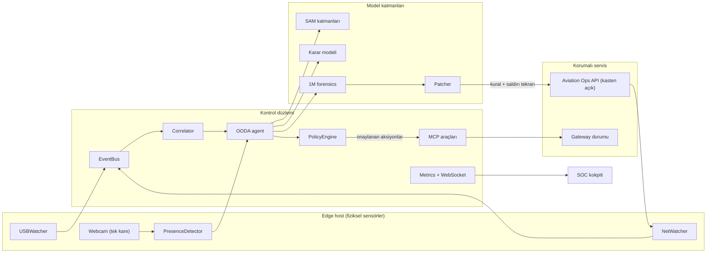

# Meta-Guardian — Proje İnceleme Notu

> Bu dosya bir arkadaşa/mentora teknik inceleme için verilmek üzere yazıldı.
> Amaç reklam değil: ne yaptığını, neyin gerçekten doğrulandığını ve neresinin
> zayıf olduğunu açıkça göstermek. Sondaki sorulara cevap aranıyor.
>
> Sürüm: hackathon tesliminden önce, 249 test yeşil, commit `fe541d9`.

---

## 1. Problem

Havalimanı ve kritik tesis operasyonlarında iki güvenlik katmanı var, ama
birbirini görmüyor:

- **Fiziksel katman:** kameralar, kartlı geçiş, USB politikası, saha personeli
- **Siber katman:** SIEM, sunucu logları, WAF, kimlik doğrulama

Somut boşluk şu: **ayrıcalıklı bir komut çalıştığı anda masada fiziksel olarak
biri var mıydı?** Bu soruyu iki katman da cevaplayamıyor.

- Log şunu söyler: `POST /api/v1/admin/command` yetkili bir oturumla çalıştı.
- Log şunu **söyleyemez**: bu oturum sahibi gerçekten orada mıydı, yoksa çalınmış
  bir token'la uzaktan mı bağlanıldı?

Bu ayrım yapılamadığı için iki tür olay haftalarca fark edilmez:

1. **Ghost attack:** masa boşken uzaktan yürütülen ayrıcalıklı işlem
2. **Credential misuse:** gerçek kullanıcı masada otururken, onun token'ıyla
   başka biri uzaktan işlem yapıyor

İkincisi özellikle sinsi: log'da gerçek kullanıcının işlemiyle **birebir aynı**
görünür.

Bu fikir Sabiha Gökçen'deki saha deneyiminden çıktı: fiziksel güvenlik ve siber
güvenlik ayrı bütçeler, ayrı ekipler, ayrı alarmlar. Aralarındaki olayı kimse
kanıtlayamıyor.

---

## 2. Ne yapıyor (somut)

Bir olay tetiklendiğinde sistem şu zinciri **otomatik** yürütüyor:

1. **Tetikleme** — iki gerçek kaynak:
   - Çıkarılabilir medya takıldı (`psutil`, sadece removable filtresi) ve
     içinde şüpheli dosya var (`.ps1`, `.exe`, `.bat` …), SHA-256 ile
   - Korumalı servisin audit log'una şüpheli istek düştü (yetkisiz toplu veri
     çekme, ayrıcalıklı komut, iptal edilmiş oturum)
2. **Korelasyon** — olaylar 30 sn pencere içinde birleştirilir (USB + ağ aynı
   olay mı?), imza bazlı cooldown ile tekrar engellenir
3. **Fiziksel kanıt** — olay anında kameradan **tek kare** alınır
   (30 FPS video akışı yok). Kare, kalibre edilmiş temiz bir baseline ile
   karşılaştırılır → "operatör var mı" sorusu
4. **Segmentasyon** — aynı kare bir segmenter'a gider, piksel maskesi üretilir
   (kanıt olarak, karar için değil — aşağıda netleştiriyorum)
5. **Karar** — model (OODA döngüsü: Observe→Orient→Decide→Act) bir **öneri**
   üretir: sınıflandırma, güven skoru, hangi aksiyonlar
6. **Politika kapısı** — deterministik kod modelin önerisini **onaylar, bekletir
   veya reddeder**. Model burada yetkili değil:
   - bilet + operatör var → alarm bastırılır
   - ayrıcalıklı komut + operatör yok → otomatik karantina
   - güven ≥ 0.85 → otomatik; 0.50–0.85 → insan onayı; < 0.50 → sadece izle
   - dakikada N aksiyon sınırı
7. **Müdahale (MCP araçları)** — gerçek yan etkiler:
   - USB'deki dosyayı salt-okunur karantina kasasına taşır (+ SHA-256 makbuz)
   - Saldırgan IP'sini canlı gateway'de bloklar
   - Oturumu düşürür
   - Yetkisiz süreci sonlandırır (allowlist + korumalı PID reddi)
8. **Adli analiz** — sanitize edilmiş olay paketi + 30 günlük SIEM arşivinden
   seçilmiş satırlar 1M-bağlam modeline gider. Gelen raporda **her alıntı gerçek
   dosya satırı ve metniyle doğrulanır**; uydurulmuş satır varsa rapor reddedilir
   ve deterministik manifest raporuna düşülür.
9. **Kendi kendini yamalama** — model **kod yazmaz**. Önceden onaylanmış bir
   şablon seçer, kural canlı servise yüklenir, **aynı saldırı tekrar atılır** ve
   `HTTP 200` → `HTTP 403` olması zorunlu. Olmazsa otomatik rollback.
10. **Kanıt** — her olay için indirilebilir vaka dosyası (Markdown + JSON):
    olaylar, kamera kanıtı, model kararı, politika çıktısı, aksiyon sonuçları,
    adli alıntılar, yama sonucu ve parmak izi.

---

## 3. Nasıl çalışıyor (mimari)



**Dosya yapısı (ürün kodu ~9.600 satır, test ~4.600 satır):**

| Alan | Satır | Ne var |
|---|---|---|
| `backend/edge/` | ~2.050 | watcher'lar, correlator, policy engine, OODA, MCP |
| `backend/vision/` | ~990 | kare yakalama, ROI, presence, SAM köprüsü |
| `backend/cloud/` | ~930 | sanitizer, forensics, patcher, citation doğrulama |
| `backend/llm/` | ~590 | mock / replay / live / record sağlayıcı katmanı |
| `backend/` (kök) | ~2.800 | FastAPI kontrol merkezi, hedef servis, case file, netguard |
| `frontend/` | ~2.180 | vanilla JS/CSS kokpit (build yok, Streamlit yok) |

**Teknoloji seçimleri ve gerekçeleri:**

| Karar | Gerekçe |
|---|---|
| Vanilla JS, Streamlit yok | Hackathon kuralları Streamlit'i düşük değer olarak işaretliyor |
| Model **kod yazmıyor**, şablon seçiyor | Güvenlik ürününde LLM'in ürettiği kodu çalıştırmak savunulamaz |
| Karar deterministik kapıdan geçiyor | Model yanılabilir; yıkıcı aksiyon onun yetkisinde olmamalı |
| 30 FPS video yok, olay başına 1 kare | Gizlilik + bant genişliği + maliyet |
| Buluta giden paket sanitize | Kullanıcı yolu, oturum belirteci maskelenir; görüntü LLM'e gitmez |

---

## 4. Neyin gerçekten doğrulandığı — ve neyin doğrulanmadığı

Bu bölüm projenin en önemli kısmı. Jüri/mentor bunu soracak.

### Doğrulandı (tekrar çalıştırılabilir)

| İddia | Kanıt |
|---|---|
| Gerçek HTTP saldırısı → tespit → müdahale | `python scripts/trigger_attack.py --exfil --watch --patch` |
| Yama kanıtı `HTTP 200 → 403` | aynı script, `PATCH VERIFIED` çıktısı |
| Containment gerçek yan etki üretiyor | dosya karantinaya taşınıyor, gateway'de IP bloklu |
| 1M bağlam gerçekten kullanıldı | tek istekte **1.026.768 input token**, 7/7 alıntı satır-doğrulanmış, `docs/FULL_ARCHIVE_RUN.md` |
| SAM gerçek model çıktısı veriyor | Modal `sam-vit_b`, maske bayt bayt modelin çıktısı, `scripts/test_modal_sam.py --bridge` |
| Naif kural motoruna karşı fark | recall %50→%100, yanlış alarm %100→%0, `docs/BENCHMARK.md` |
| Test disiplini | 249 test, CI'da Ubuntu'da yeşil, Docker imajı build oluyor |

### Doğrulanmadı / sınırlı

| Konu | Durum |
|---|---|
| Gerçek USB bellek ile uçtan uca | **hiç denenmedi** (donanım yoktu). Sadece sentetik/klasör testi var |
| Gerçek webcam ile karar | denenmedi; baseline kalibrasyonu yapılmadı |
| Canlı LLM modu (`LLM_MODE=live`) tam zincir | mock ile ölçüldü; Baseten çağrıları ayrı ayrı doğrulandı, tam akışta değil |
| SAM GPU'da | Modal CPU'da çalıştı (~20 s); GPU için ödeme yöntemi gerekiyor |
| Ölçülen gecikmeler | tek makine, mock mod: MTTD 236–371 ms, MTTR 42–93 ms, patch 115–123 ms |

**Kritik dürüstlük notu:** karar aşamasında `operator_present` bilgisini **SAM
vermiyor.** Kare farkı (basit hareket heuristiği) veriyor. SAM sadece vaka
dosyasına maske üretiyor. "SAM karar verdi" demek yanlış olur.

---

## 5. Bilinen zayıflıklar (dürüst liste)

### Z1 — Bilet ↔ kimlik bağı yok (gerçek açık)

`backend/edge/policy_engine.py`, `evaluate()`:

```python
ticket = self.tickets.find_covering(moment)
if ticket is not None and operator_present:
    return self._authorized(...)      # BENIGN_AUTHORIZED
```

`ticket.operator` **hiç karşılaştırılmıyor**; oturum sahibiyle/rolüyle bağ
kurulmuyor. Sonuç: herhangi biri bir bakım bileti açarsa, o pencerede masada
biri oturduğu sürece **her türlü ayrıcalıklı işlem** alarm üretmeden geçer.

Oturum kayıtları zaten kimlik ve rol taşıyor:

```python
sessions = {
  "session-ops-valid": {"operator": "ops-engineer", "role": "operator"},
  "session-7f3a9c":     {"operator": "ops-admin",    "role": "admin"},
}
```

Yani eksik olan veri değil, **karşılaştırma**.

### Z2 — Kamera tek bir dar soruyu cevaplıyor

"Bu ayrıcalıklı işlem anında masada fiziksel biri var mı?" Kimlik, yetki, niyet
hakkında hiçbir şey söylemiyor. Ayrıca:

- Senaryo A'da (USB + veri sızması) kamera **kararı değiştirmiyor**; oradaki
  tespit tamamen yazılımsal. Kamera A'da dekor.
- Masada oturan bir saldırgan `operator_present=true` üretir → ghost attack
  sayılmaz (bilet yoksa yine alarm çalar, ama ghost sınıflandırması olmaz).
- Uzaktan yapılan **meşru** IT müdahalesinde masa boşsa, bilet sahibi doğru
  kişi olsa bile sistem bunu "ghost" olarak okuyabilir. **Bu bir yanlış alarm
  riski ve şu an çözülmüş değil.**

### Z3 — Wazuh'tan farkı yeterince keskin değil

| Yetenek | Wazuh | Meta-Guardian |
|---|---|---|
| Log kuralı + FIM | olgun | kısmi |
| Active response (IP blok, süreç öldür) | var | var |
| 30 gün bağlamda akıl yürütme | yok | var (1M, satır doğrulamalı) |
| Model önerisini deterministik kapıdan geçirme | yok | var |
| Yamayı kanıtlama (200→403) | **yapamaz** | var |
| Fiziksel durumu karara katma | yok | var (dar) |
| Kimlik ↔ oturum ↔ bilet bağı | kısmi | **yok (Z1)** |
| Kurcalanamaz kanıt zinciri | yok | **yok** |

Yani şu anki gerçek fark: **kanıtlanmış müdahale + doğrulanmış kanıt.**
Kamera farkı henüz dar; Z1 ve Z2 bunu zayıflatıyor.

### Z4 — Operasyonel sınırlar

- Saldırgan, kurban ve savunmacı aynı makinede. `X-Forwarded-For` opt-in bir
  demo kolaylığı, gerçek proxy değil.
- Gateway blocklist ve oturum iptalleri bellekte; hedef servis yeniden
  başlarsa sıfırlanır (incident'lar diske yazılıyor).
- OODA hattı tek kilit ile serileştirilmiş; yavaş canlı model çağrısı sonraki
  olayı kuyruğa alır.
- Removable algılama dosya sistemi/mount seçeneklerine bakıyor; NTFS ve
  `removable` bayrağı olmayan çubuklar atlanır (demo için `MG_USB_ACCEPT_ALL=1`
  var, her olaya işaretleniyor).

---

## 6. Öneriler (eklemek üzerine — kaldırmak değil)

Aşağıdakiler projeyi Wazuh'tan ayıracak ve Z1/Z2/Z3'ü kapatan işler. Hiçbiri
yeni ağır bağımlılık gerektirmiyor.

### A1 — Bilet ↔ kimlik ↔ rol bağı (zorunlu, ~45 dk)

`policy_engine.evaluate()` içinde biletin sahibi ile oturumun sahibini
karşılaştır, rol kontrolü ekle (`role == admin` gerekli). Bilet varsa bile
sahibi uyuşmuyorsa bastırma yok.

Etki: Z1 kapanır. Gerçek bir yetki yükseltme yolu kapanır.

### A2 — "Konsol çakışması" tespiti (asıl farklılaştırıcı, ~3 saat)

Oturuma köken bilgisi ekle (hangi IP, hangi kullanıcı, hangi rol). Sonra kamera
şu soruyu sorar: *"Bu ayrıcalıklı oturum aktifken masada fiziksel olarak biri
var mı?"*

| Durum | Kamera | Beklenen karar |
|---|---|---|
| Meşru uzaktan IT, bilet sahibi = oturum sahibi, masa boş | boş | `BENIGN_AUTHORIZED` |
| Saldırgan çalınmış token'la uzaktan, gerçek kullanıcı masada | **dolu** | `CREDENTIAL_MISUSE` (yeni sınıf) |
| Bilet yok, masa boş | boş | `GHOST_ATTACK` |
| Bilet yok, masa dolu | dolu | `THREAT_CRITICAL` |

İkinci satır yeni bir saldırı sınıfı: **T1078 Valid Accounts** + fiziksel/uzak
çakışma. Hiçbir SIEM bunu göremez çünkü log'da gerçek kullanıcının işlemiyle
birebir aynı görünür. **Uzaktan IT itirazı da burada çözülüyor** — yanlış alarm
değil, ayırt edilebilir bir durum haline geliyor.

Uyarı: `policy_engine`'e dokunuyor (şu an "dondurulmuş" alan). Ama orada gerçek
bir açık var; dondurmanın amacı açıkları korumak değil.

### A3 — Kurcalanamaz kanıt zinciri (~1 saat, risk ~0)

Her vaka dosyası `prev_hash` + kendi `sha256`'sini taşısın. Zincir bozulursa
doğrulama hatası verir. `hashlib` standart kütüphanede.

Etki: "vaka dosyası sessizce değiştirilemez" iddiası savunulabilir olur.

### A4 — ATT&CK eşlemesi (~45 dk, risk ~0)

Senaryoları MITRE tekniklerine bağla: T1200 (Hardware Additions), T1078 (Valid
Accounts), T1567 (Exfiltration Over Web Service). Tablo + kokpitte küçük rozet.

Etki: güvenlik jürisi için ciddiyet işareti; Z3'teki farkı netleştirir.

### Yapılmaması önerilenler

- PDF üretimi (Docker imajını ağır C kütüphanelerine bağımlı kılar; `.md`/`.json`
  zaten endüstri standardı, tarayıcıdan PDF'e çevrilebilir)
- Sahte Active Directory / şirket simülasyonu (Indie track'te ters teper)
- Kafka/Redis/SQLite eklemek (kapsam ölümü; tek kişilik 10 günlük takvim)
- Yeni senaryo eklemek (A2 zaten yeni bir sınıf getiriyor)

**Toplam: ~5,5 saat.**

---

## 7. Demo anlatımı — hangi cümle doğru, hangisi değil

| ❌ Yanlış | ✅ Doğru |
|---|---|
| "SAM karar verdi" | "Kare farkı karar verdi; SAM maskeyi kanıt olarak üretti" |
| "Sistem her şeyi canlı modelle yapıyor" | "SAM ve 1M analiz canlı; karar katmanı demo modunda çalışıyor" (`mode: mock` ekranda görünür) |
| "Kamera görüntüsü hiçbir yere gitmiyor" | "Görüntü LLM'e gitmiyor; segmentasyon için seçilen uca (Modal/Meta) gidiyor, kalıcı saklanmıyor, kimlik çıkarılmıyor" |
| "Yama otomatik yapıldı" (düğmeye basınca) | "Yama ayrı adım: `patch` endpoint'i; 200→403 kanıtlanana kadar `PATCHED` sayılmaz" |
| "Kimlik tanıma yapıyoruz" | "Kimlik tanımıyoruz; tek soru: o anda masada biri var mıydı" |

---

## 8. İnceleyene sorular

1. **Z1 (bilet ↔ kimlik bağı yok)** sence gerçekten kritik mi, yoksa demo
   kapsamında kabul edilebilir mi? A1'i önceliklendirmeli miyim?
2. **A2 (konsol çakışması)** fikri sağlam mı? "Gerçek kullanıcı masada, token'ı
   uzaktan kullanılıyor" durumunu bu şekilde modellemek savunulabilir mi, yoksa
   yanlış pozitif üretir mi?
3. **Uzaktan IT müdahalesi** senaryosu A2 ile gerçekten çözülüyor mu? Gözden
   kaçırdığım bir durum var mı (ör. VPN, atlama sunucusu, çoklu operatör)?
4. **Kamera** olmadan bu proje Wazuh'tan yeterince ayrışır mı? Ayrışmıyorsa
   hangi tek özellik en çok fark yaratır?
5. Hackathon jürisi karşısında **en kırılgan iddia** hangisi sence? Nerede
   "bunu kanıtla" derler?
6. 5,5 saatlik A1–A4 planı doğru öncelik mi, yoksa bunun yerine demo/video
   kalitesine mi yatırım yapmalıyım?

---

## 9. Hızlı referans

| Kaynak | İçerik |
|---|---|
| `README.md` | kurulum, mimari, ölçüm tabloları, sınırlamalar |
| `docs/THREAT_MODEL.md` | tehdit modeli, güven sınırları, sertleştirme tablosu |
| `docs/BENCHMARK.md` | naif kural motoru vs Meta-Guardian |
| `docs/FULL_ARCHIVE_RUN.md` | 1M bağlam kanıtı (token sayısı, alıntı doğrulama) |
| `docs/DEMO_RUNBOOK.md` | demo sırası, kalibrasyon, bozulma kurtarma |
| `docs/DOCKER.md` | konteyner mimarisi ve kısıtları |

Komutlar:

```bash
python -m pytest                          # 249 test
docker compose up --build                 # target-api + soc-cockpit
python scripts/trigger_attack.py --exfil --watch --patch
python scripts/test_modal_sam.py --bridge # SAM gerçek mi
python scripts/benchmark_baseline.py --patch
```
